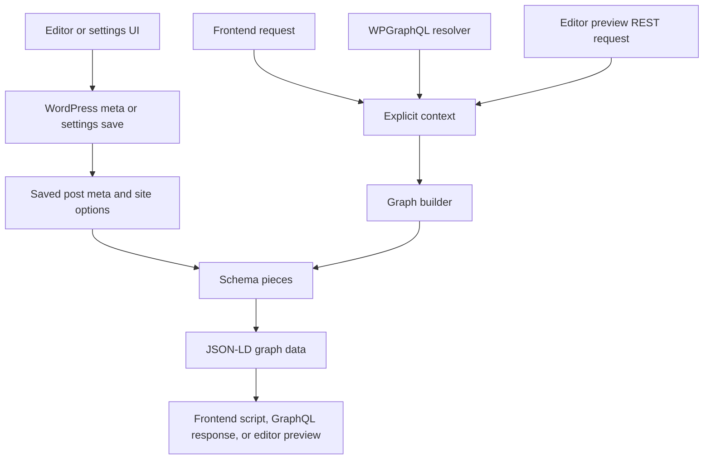

# Project structure

PHP generates schema. TypeScript provides the WordPress editor and settings interfaces. Start with the folder responsible for the behavior you want to change.

## Entry points

- `better-schema-markup.php` loads PHP modules explicitly, in dependency order. It is the map of runtime registration; preserve loading order when moving files.
- `src/editor/index.tsx` registers the block editor panel and mounts the classic editor controls.
- `src/settings/index.tsx` mounts the settings screen.
- `uninstall.php` loads cleanup independently of normal plugin activation.

The two TypeScript entries compile to `build/index.*` and `build/settings.*`. WordPress loads those generated assets, not the TypeScript files. Regenerate them with `vp build`.

## Admin interfaces: src

| Folder             | Responsibility                                                                             |
| ------------------ | ------------------------------------------------------------------------------------------ |
| `editor/`          | Block panel, classic editor, shared field composition, and type picker                     |
| `editor/fields/`   | Event, recipe, FAQ, and custom JSON-LD controls                                            |
| `editor/preview/`  | Preview requests, response validation, display, and rich-results links                     |
| `settings/`        | Site settings screen, business controls, settings readers, and SEO controls                |
| `settings/import/` | Import report validation and human-readable summaries                                      |
| `schema/`          | Shared TypeScript schema types, meta guards, and post-detail readers; no schema generation |
| `api/`             | Authenticated requests to the WordPress backend                                            |
| `hooks/`           | Reusable hooks independent of a particular screen                                          |
| `components/`      | Shared labelled form controls in `form-fields.tsx`                                         |
| `components/ui/`   | Reusable buttons, inputs, selectors, layout, and other UI primitives                       |
| `styles/`          | Shared admin CSS; Tailwind scans all of `src/`                                             |

Unit tests stay beside the modules they test. The root `build-output.test.ts` checks the generated browser scripts. Prefer direct imports; put reusable code in the shared folders rather than importing from one screen into another.

## Server behavior: includes

| Folder           | Responsibility                                                                                    |
| ---------------- | ------------------------------------------------------------------------------------------------- |
| `schema/`        | Explicit contexts, graph assembly, custom merging, validation hints, and JSON-LD serialization    |
| `schema/pieces/` | Individual schema entities such as Article, Recipe, and WebSite                                   |
| `data/`          | Post meta, options, sanitizers, defaults, and saved identity/business/detail readers              |
| `admin/`         | Editor assets, classic editor saving, settings page, backend API configuration, and preview route |
| `integrations/`  | Frontend output, public URL mapping, WPGraphQL, SEO compatibility, and imports                    |
| `lifecycle/`     | Site and multisite uninstall cleanup                                                              |
| `support/`       | Shared text normalization helpers                                                                 |

These folders organize existing procedural modules. Files can contain related registration and helper functions; folder names do not imply a new class system. Keep `better_schema_` function and hook names stable. Schema pieces receive explicit context and must not depend on editor UI or output hooks.

## How the parts connect

The block editor saves registered meta through WordPress. The classic editor submits changed meta with the post form. Settings use the authenticated settings API. Preview passes unsaved overrides temporarily into the same PHP graph builder without persisting them.

## Where to make common changes

- **Change an entity:** start in `includes/schema/pieces/`; inspect its PHP test in `tests/`. Register a new piece in the graph builder and plugin bootstrap when needed. See [Schema pieces](schema-pieces.md).
- **Add an editor field:** use `src/editor/fields/`, shared readers in `src/schema/`, and registration/sanitization in `includes/data/`. Both editors compose the same controls. See [Editor UI](editor-ui.md).
- **Add a site setting:** connect `includes/data/settings.php`, `src/settings/settings-data.ts`, and the settings screen; add its uninstall cleanup. See [WordPress integration](wordpress-integration.md).
- **Change output delivery:** use `includes/integrations/` for frontend or GraphQL wiring; keep entity rules in the shared graph builder and pieces. See [Schema architecture](schema-architecture.md).
- **Change shared appearance:** start in `src/components/` and `src/styles/`, preserving WordPress styling boundaries.

PHP tests remain in `tests/`, with shared bootstrap and graph assertions. Build and release scripts live in `bin/`; generated assets live in `build/`. Use [Project workflow](project-workflow.md) and [Testing](testing.md) for commands and verification requirements.
